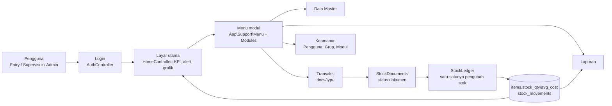
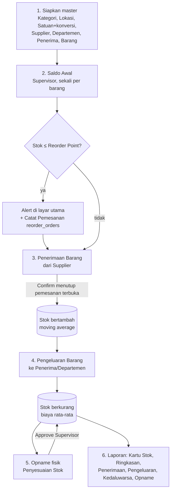
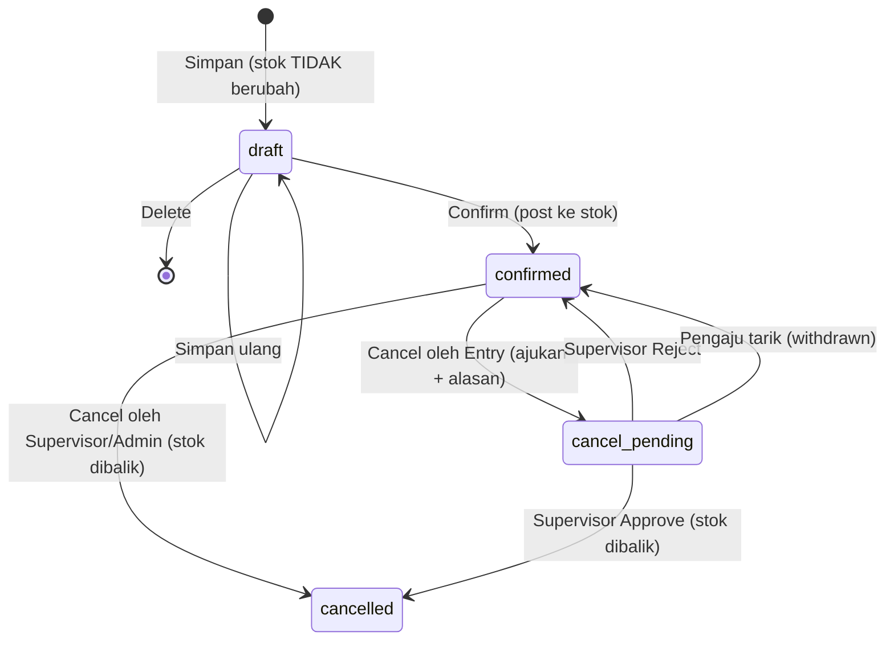
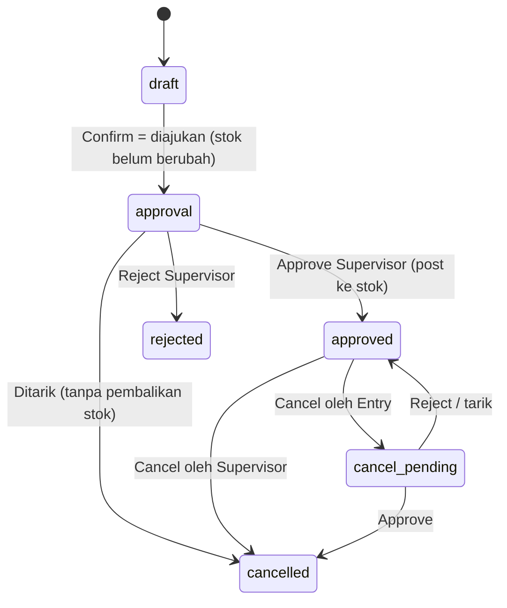
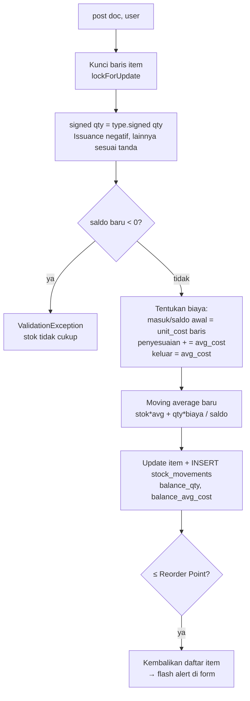
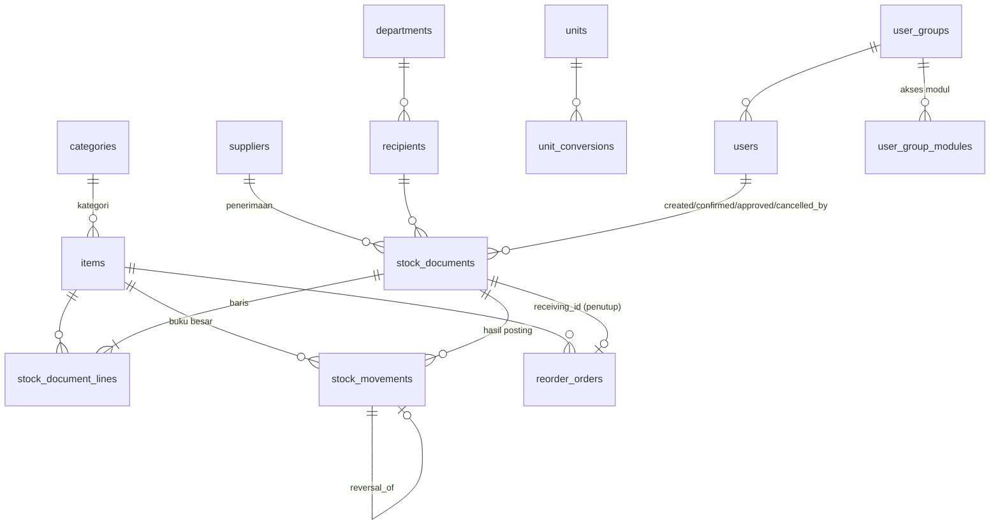
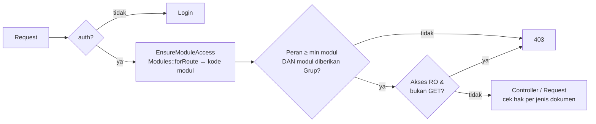

# Technical Guide Stoku (sstock) — Flow Besar

Dokumen ini memberi gambaran besar cara kerja Stoku dari hulu ke hilir. Detail aturan kerja ada di `CLAUDE.md` / skill `stoku`, daftar fitur dan sisa pekerjaan di `HANDOVER.md`. Diagram memakai Mermaid (tampil di GitHub dan editor yang mendukungnya).

## 1. Gambaran sistem

Stoku adalah aplikasi persediaan sederhana: **master data** didefinisikan sekali, **dokumen stok** mencatat setiap perubahan, **buku besar** menyimpan saldo, dan **laporan + dashboard** membaca hasilnya.

| Lapisan | Isi | Lokasi |
|---|---|---|
| Stack | Laravel 13, PHP 8.4, MySQL 8 (tes: SQLite in-memory), Vite + Tailwind 4 | `composer.json`, `vite.config.js` |
| UI | Komponen DevLib `x-dl::*` (paket `telasih/devlib`, repo `../devlib`); semua layar deklaratif, tanpa HTML mentah | `resources/views` |
| Terjemahan | Label English di kode diterjemahkan kamus ke Indonesia | `app/Support/Indonesian.php`, `lang/id` |
| Rute + penjagaan | Satu file rute, middleware `module` menjaga akses per modul | `routes/web.php`, `EnsureModuleAccess` |
| Logika bisnis | 3 service: siklus dokumen, buku besar stok, valuasi | `app/Services` |
| Data | Master + dokumen + buku besar | `database/migrations` |



## 2. Alur bisnis end-to-end



Ringkas per tahap:

1. **Master** — kode barang otomatis `{AWALAN KATEGORI}-{URUT 4 DIGIT}[-{YYMM KEDALUWARSA}]` (`Item::nextCode`); kode, kategori, kedaluwarsa terkunci setelah disimpan. Departemen dan Penerima bisa ditambah cepat dari dalam form dokumen.
2. **Saldo Awal** — hanya Supervisor; ditolak bila barang sudah punya pergerakan (pakai Penyesuaian).
3. **Penerimaan** — boleh satuan lain, dikonversi ke satuan stok lewat `UnitConverter` (konversi belum ada = ditolak).
4. **Pengeluaran** — penerima wajib; stok tidak boleh negatif.
5. **Penyesuaian** — qty dokumen = selisih hitung fisik (`counted_qty - system_qty`); butuh persetujuan.
6. **Laporan** — filter tanggal dari-sampai; harga/nilai hanya untuk Supervisor.

## 3. Siklus dokumen (state machine)

Empat jenis dokumen satu pengendali (`StockDocumentController`, rute `docs/{type}`: `opening | receiving | issuance | adjustment`), satu service (`StockDocuments`). Controller membaca `_action` dari tombol form: `save, confirm, delete, cancel, approve, reject`.

**Saldo Awal, Penerimaan, Pengeluaran**



**Penyesuaian Stok**



Aturan kunci:

- **Nomor dokumen** `PREFIX-YYMM-NNNN` (OPN/RCV/ISS/ADJ), urut per jenis per bulan.
- **Confirm** memposting dalam satu transaksi DB; tanggal/jam dokumen = saat Confirm (Saldo Awal: tanggal pilihan pengguna). Dokumen terkonfirmasi terkunci; koreksi lewat Penyesuaian.
- **Approve Penyesuaian** ditolak bila stok berubah sejak dihitung (`system_qty` ≠ stok sekarang) — Reject lalu hitung ulang.
- **Cancel** wajib alasan (min. 3 huruf). Sebelum pembatalan/pengajuan, `StockLedger::assertReversible` menghitung apakah stok cukup untuk menarik dokumen; bila tidak, ditolak (buat Penyesuaian). Hasil hitungan tampil sebagai peringatan di form.
- **Penerimaan** yang di-Confirm menutup `reorder_orders` terbuka untuk barang itu; bila dibatalkan, pemesanan dibuka lagi.
- Tombol Confirm/Delete/Cancel/Approve/Reject berasal dari status DevLib (`x-dl::form kind="document" :pipeline="true"`), tidak dibuat manual. Jejak tiap tahap masuk `log` form.

## 4. Buku besar stok (inti integritas data)

Hanya `App\Services\StockLedger` yang boleh mengubah `items.stock_qty` dan `items.avg_cost` (`forceFill`; kolom ini sengaja tidak mass-assignable).



- `stock_movements` **tidak pernah diubah/dihapus**. Pembalikan (`reverse`) menulis baris baru dengan `reversal_of` menunjuk baris asal; di Kartu Stok ditandai "(BATAL)".
- Penyesuaian dengan selisih 0 dilewati (tidak ada pergerakan).
- `StockValuation::series` membangun grafik nilai persediaan per minggu dari `balance_qty × balance_avg_cost` di buku besar (hanya Supervisor).

## 5. Model data



Catatan kolom penting: `items.location` menyimpan **kode** lokasi; `stock_documents.recipient/department` menyalin **nama** master (tetap terbaca bila master berubah); `stock_document_lines.entered_qty/unit/unit_cost` menyimpan yang diketik bila beda satuan dengan stok.

## 6. Akses dan keamanan



- Peran: `data_entry` < `supervisor` < `administrator`. Administrator selalu penuh. Pengguna tanpa Grup memakai bawaan peran (`Modules::defaults`).
- Grup memberi akses per modul: Tidak ada / RO / RW (`user_group_modules.access`).
- **Daftar modul tunggal** `App\Support\Modules` menjadi sumber menu, pengaturan Grup, daftar modul, dan penjagaan rute. Modul baru = tambah satu baris di sana.
- Middleware tambahan: `supervisor` (ubah Item, Satuan, Kategori, Lokasi, laporan Penyesuaian), `administrator` (Pengguna, Grup, Modul).
- Approve/Reject hanya Supervisor (403 lainnya). Login: wallpaper acak; lupa password via tautan e-mail (throttle 5/menit, berlaku 60 menit, sekali pakai).
- Celah yang diketahui: belum ada pemisahan tugas pembuat vs penyetuju; tombol Simpan pada modul RO masih tampil (server menolak).

## 7. Layar utama dan laporan

- **Layar utama** (`HomeController`): 6 KPI yang bisa diklik, alert Reorder Point (barang `belowReorderPoint`) dengan status pesanan, alert kedaluwarsa (`nearExpiry`), antrean persetujuan (Supervisor), grafik nilai persediaan (Supervisor).
- **Pemesanan ulang**: "Catat Pemesanan" membuat `reorder_orders`; ditutup otomatis oleh Penerimaan Confirm, dibuka lagi bila penerimaan dibatalkan.
- **Laporan** (`ReportController`, `x-dl::report`): Kartu Stok, Ringkasan Stok, Penerimaan, Pengeluaran (hanya dokumen Confirm/pembatalan-menunggu), Kedaluwarsa, Opname & Penyesuaian (Supervisor).

## 8. Konvensi pengembangan

| Topik | Aturan |
|---|---|
| Bahasa | Semua tampilan Indonesia; label baru ditambah ke `Indonesian`; pesan validasi di `lang/id/validation.php`; mata uang tetap `IDR` |
| Grid | Transaksi polos (nomor tebal + badge Status berwarna); master berkotak warna per baris (`box`, `hue` dari `Palette`) |
| Form | Tombol Kembali selalu ke grid (`:back`), tidak boleh terkirim dua kali |
| Seeder | Data contoh hanya di `database/seeders`; transaksi contoh lewat `StockDocuments` → `StockLedger`; skema berubah = seeder ikut berubah |
| DevLib | Perubahan harus opt-in (tmerp memakai perilaku lama); perbaiki akar masalah di DevLib |
| Git | Commit + push setiap perubahan; jangan force-push; jangan commit `.env` |

Menambah **jenis dokumen baru**: tambah case di `StockDocumentType` (slug, prefix, label, tanda qty), daftarkan di `whereIn` rute `docs/{type}` dan di `Modules` (`forRoute` + `all`), tambah aturan di `StockDocumentRequest`/`StockDocuments`, perbarui kamus, seeder, dan tes siklus di `DocumentLifecycleTest`.

## 9. Operasional

```bash
composer setup     # install, .env, key, buat DB+user MySQL, migrate, seed, build
composer sample    # migrate:fresh --seed (MENGHAPUS isi DB), lalu jalankan sstock:import-geo
php artisan test   # SQLite in-memory
vendor/bin/pint --dirty
npm run build      # wajib setelah mengubah resources/css/app.css
```

- Akun uji (hanya pengembangan, ganti sebelum produksi): `admin`, `supervisor`, `entry` (lihat `UserSeeder`).
- Tes kunci: `DocumentLifecycleTest` (Confirm/Cancel/persetujuan), `StockFlowTest` (alur stok), `SecurityTest` (akses), `SeedersTest` (seeder idempoten, stok = buku besar), `ItemCodeTest`.
- Produksi: isi SMTP (`MAIL_*`; sekarang `log`), ganti password akun uji. `database/sql/sstock_mysql_ddl.sql` ketinggalan; migrasi adalah sumber kebenaran.

## 10. Belum dikerjakan

Cetak nota dokumen tunggal; pemisahan tugas pembuat vs penyetuju; perkiraan tiba pemesanan dari `lead_time_days`; batalkan/ubah pencatatan pemesanan; regenerasi DDL referensi; SMTP produksi; wallpaper portrait untuk HP.
